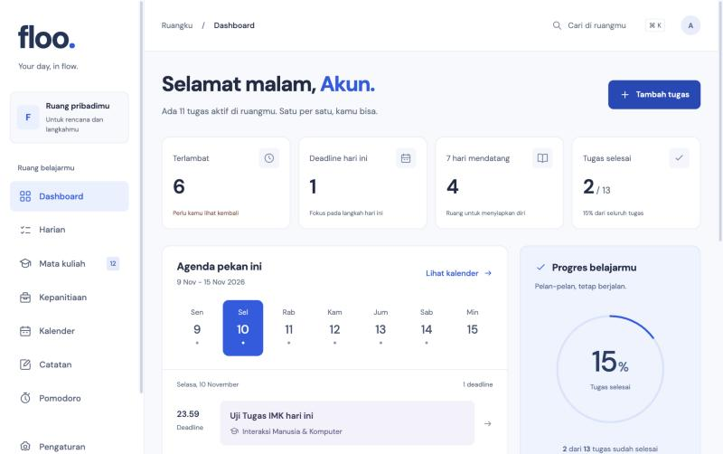
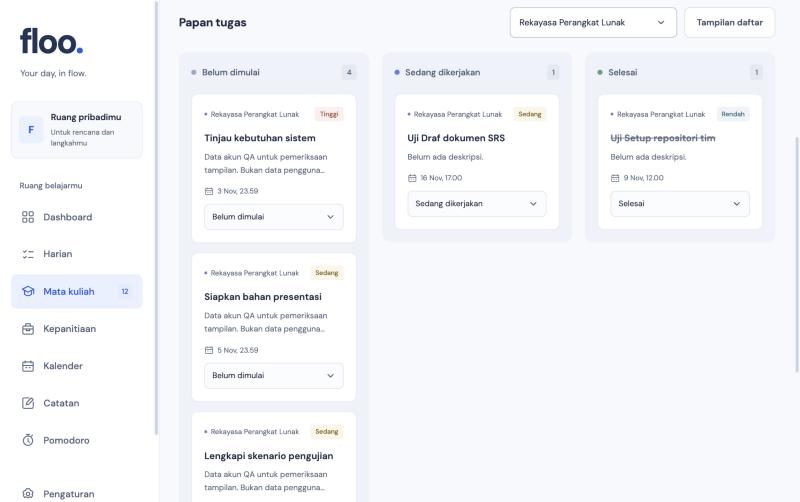
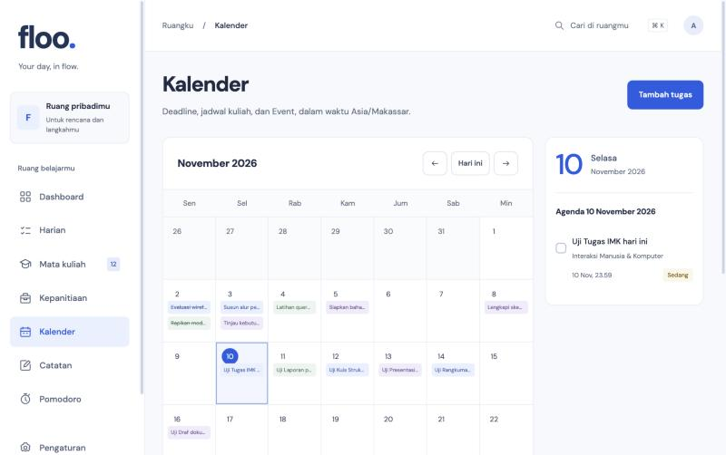
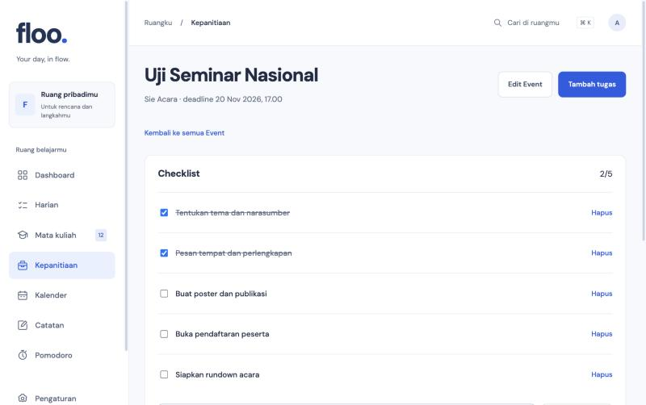
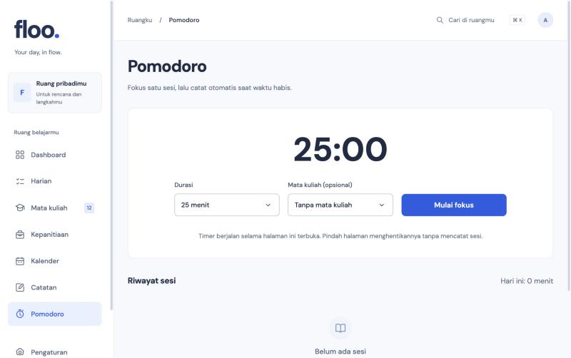

# FLOO: Productivity App

FLOO adalah aplikasi produktivitas berbasis web untuk mahasiswa. Satu tempat untuk mengatur mata kuliah, tugas, jadwal, catatan, sesi fokus, dan kepanitiaan, supaya deadline tidak terlewat dan kegiatan kuliah serta organisasi tidak saling bertabrakan.

## Project By KELOMPOK PENERBANG ROKET

Koordinator:
- I Made Christian Kusuma Antika (NIM. 2508561051)
Anggota:
- Dimas Shakuntala Adi Pratama (NIM. 2508561047)
- Ida Nyoman Satwika Chandra Astawa (NIM. 2508561061)
- I Made Mahasurya Adiputera (NIM. 2508561052)

## Untuk Apa FLOO?

Mahasiswa biasanya membagi urusan ke banyak tempat: tugas di chat, jadwal di kalender, catatan di aplikasi lain, panitia di grup lain. FLOO menyatukannya dalam satu workspace yang sederhana, gratis, dan bisa dibuka dari browser laptop maupun ponsel.

## Tampilan

| Dashboard | Mata Kuliah dan Tugas |
| --- | --- |
|  |  |

| Kalender | Kepanitiaan |
| --- | --- |
|  |  |

| Pomodoro |
| --- |
|  |

## Fitur untuk Pengguna

**Akun**
- Daftar dengan email dan password (dengan verifikasi email) atau masuk langsung dengan akun Google.
- Lupa password? Pulihkan lewat email.
- Data tersimpan di akunmu dan hanya bisa dibuka lewat akun itu.

**Dashboard**
- Ringkasan tugas, agenda pekan ini, progres, dan pintasan ke mata kuliah.
- Filter tugas berdasarkan status atau prioritas.

**Mata Kuliah dan Tugas**
- Tambah, ubah, dan hapus mata kuliah. Mata kuliah yang masih punya tugas tidak bisa dihapus, jadi tugasmu tidak hilang tanpa sengaja.
- Tugas punya status (todo, in progress, done), prioritas, dan deadline wajib, tampil sebagai papan Kanban atau daftar.
- Mahasiswa Informatika Udayana bisa memakai daftar mata kuliah semester 1-4 yang sudah tersedia.

**Kalender**
- Kalender bulanan yang menggabungkan deadline semua mata kuliah, plus agenda harian.
- Waktu mengikuti zona waktu yang kamu atur di profil.

**Catatan**
- Catatan per mata kuliah.

**Pomodoro**
- Timer fokus dengan riwayat sesi.

**Kepanitiaan**
- Buat Event, isi checklist dari template (seminar, lomba, bakti sosial, dan template HIMA), lalu kerjakan tugas panitia berdampingan dengan tugas kuliah.

**Pencarian cepat dan Pengaturan**
- Cari tugas, mata kuliah, dan catatan dengan `Cmd/Ctrl+K`.
- Atur nama, zona waktu, semester, serta tampilkan atau sembunyikan modul Akademik dan Kepanitiaan. Menyembunyikan modul tidak menghapus datamu.

**Belum tersedia**
Sinkronisasi Google Calendar, integrasi Gmail, notifikasi, dan aplikasi mobile native.

## Sisi Development (Ringkas)

| Bagian | Teknologi |
| --- | --- |
| Framework | Next.js (App Router), React, TypeScript |
| Backend & Auth | Supabase (Postgres, Auth, Row Level Security) |
| Validasi | Zod |
| Waktu | Luxon (deadline disimpan sebagai `timestamptz`) |
| Pengujian | `node:test` lewat tsx, plus pengujian integrasi ke Supabase |

Cara kerja singkat:
- Halaman dan API route ada di `src/app`. Tiap mutasi divalidasi dengan Zod di server sebelum disimpan.
- Data diambil sebagai satu snapshot dan dibagikan lewat React Context. Tampilan baru diperbarui setelah server memastikan data tersimpan.
- Keamanan data diatur di database: setiap tabel memakai RLS sehingga akun hanya bisa membaca dan mengubah datanya sendiri. Aplikasi hanya memakai publishable key, tanpa `service_role`.

Struktur folder:
- `src/app`: halaman, callback autentikasi, dan API
- `src/components`: workspace, form autentikasi, landing, dan ikon
- `src/lib`: validasi, waktu, tipe, template, dan klien Supabase
- `supabase`: migrasi SQL (RLS dan constraint) serta template email
- `docs`: panduan konfigurasi Supabase hosted
- `legacy/frontend`: prototipe awal, bukan bagian alur aplikasi

## Menjalankan Secara Lokal

```sh
npm ci
cp .env.example .env.local
npm run dev
```

Isi `.env.local` dengan URL proyek Supabase, publishable key, dan `NEXT_PUBLIC_APP_URL=http://localhost:3000`. Jangan commit `.env.local`.

Pada proyek Supabase yang baru, jalankan seluruh berkas di `supabase/migrations` berurutan lewat SQL Editor, lalu atur autentikasi (email, Google, redirect URL) sesuai [panduan Supabase hosted](docs/SETUP_SUPABASE_HOSTED.md).

Buka [http://localhost:3000](http://localhost:3000).

## Pengujian

```sh
npm run typecheck
npm test
npm run build
npm run test:integration
```

Pengujian integrasi membutuhkan `.test-accounts.json` berisi dua akun khusus uji (diabaikan Git). Jangan memakai akun berisi data penting. Hasil dan keterbatasan pengujian ada di [VERIFICATION.md](VERIFICATION.md), catatan desain di [DESIGN.md](DESIGN.md).

## Repositori

[https://github.com/mdchrstian/FlooProductivity](https://github.com/mdchrstian/FlooProductivity)
